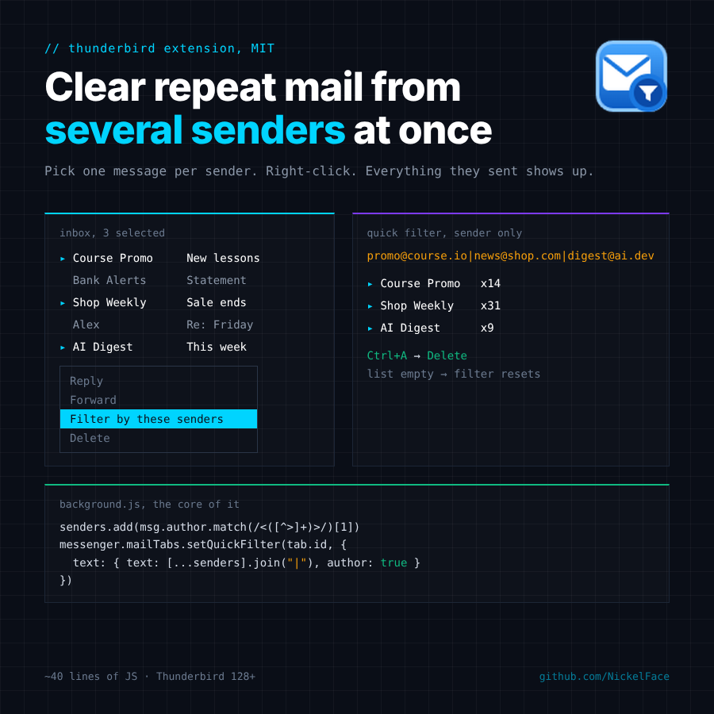

# Filter by these senders

A small Thunderbird extension for clearing out repeat mail from several senders at once.



Newsletters, course promos, shop updates. You don't read them, you don't want to keep them, and they pile up by the hundred. Gmail has "Filter messages like these" for this. Thunderbird has nothing built in, and the old add-on that did it (Gather the senders) no longer installs on current versions.

## How it works

1. Ctrl+click a few messages from different senders.
2. Right-click and choose "Filter by these senders".
3. The Quick Filter now shows every message from those senders in the folder.
4. Ctrl+A, Delete.

When the filtered list is empty, the filter resets on its own and you're back to the full folder. If you delete only part of the list, the filter stays.

## Mechanics

The extension reads the sender address of each selected message, removes duplicates, and joins them with `|`. Thunderbird's Quick Filter treats `|` as OR, so `a@x.com|b@y.com|c@z.com` matches all three. The search runs on the Sender field only, so subjects and bodies don't cause false matches.

To reset, it listens for messages being deleted or moved. After each event it checks the tab's listed messages, and if none are left it clears the Quick Filter.

About 40 lines of JavaScript, using the standard MailExtension APIs: `menus`, `mailTabs.setQuickFilter`, `mailTabs.getListedMessages`, `messages.onDeleted` and `messages.onMoved`.

## Install

From a release: download `filter-by-senders.xpi`, then in Thunderbird open Tools > Add-ons and Themes, click the gear icon and choose Install Add-on From File.

From source:

```bash
git clone https://github.com/NickelFace/thunderbird-filter-by-senders.git
cd thunderbird-filter-by-senders
zip -r filter-by-senders.xpi manifest.json background.js icons
```

For quick testing without installing, use Debug Add-ons > Load Temporary Add-on and pick `manifest.json`.

## Permissions

- `menus` adds the right-click item.
- `messagesRead` reads the sender of the selected messages.
- `accountsRead` is needed for the delete and move events.

Nothing leaves your machine. The extension makes no network requests.

## Requirements

Thunderbird 128 or newer. Tested on Ubuntu with the current Thunderbird release.

## Known limits

- IMAP accounts set to "mark as deleted" (no Trash) may not trigger the auto-reset.
- Works on the current folder only, the same as Quick Filter.

## License

MIT. Built by Maksim Lopunov with help from Claude.
